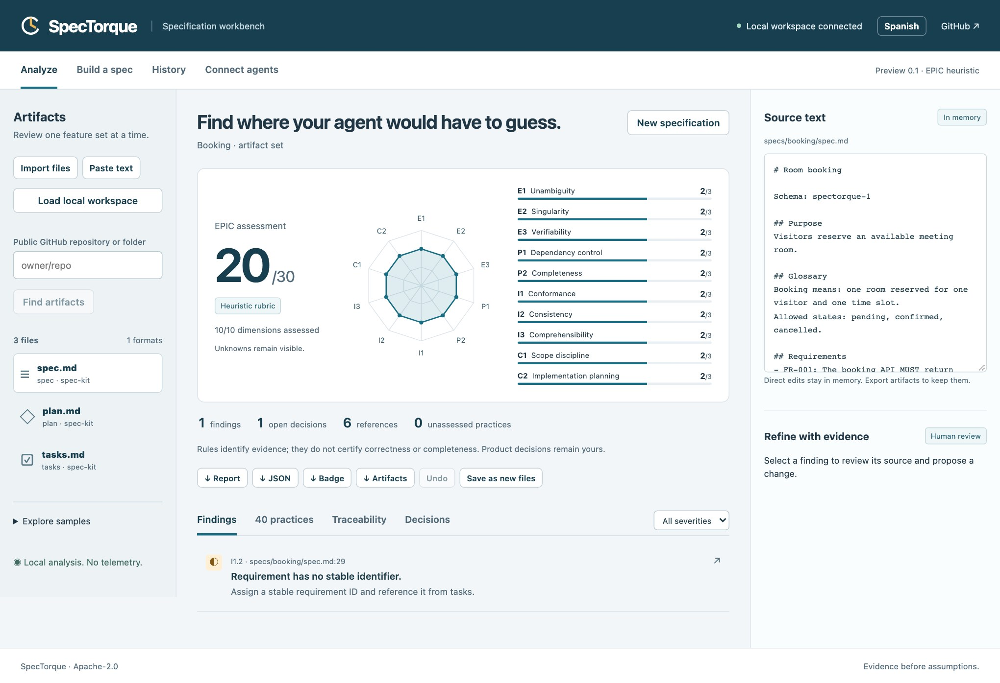

# SpecTorque

**See where your coding agent would have to guess.**

SpecTorque is a local workbench for writing and reviewing software specifications. It takes you from a rough idea or an existing Markdown workspace to a spec, plan and tasks with traceable requirements, reviewable changes and explicit open decisions.

[Quickstart](#quickstart) · [How it works](#how-it-works) · [Research](#why-wording-matters) · [Tested compatibility](docs/compatibility.md) · [Guía en español](docs/es.md)

**40 EPIC practice checks · 10 quality dimensions · English and Spanish · One deterministic engine**

## Explore the workbench

Expand a view to read its description and see the capture. Click the image for the original size.

<details open>
<summary><strong>Analyze</strong></summary>

Inspect findings at their exact source lines and see which dimensions are still unknown.

[](docs/assets/workbench/analyze.jpg)

</details>

<details>
<summary><strong>Build a spec</strong></summary>

Answer guided questions to turn a project brief into a spec, plan and tasks.

[](docs/assets/workbench/build.jpg)

</details>

<details>
<summary><strong>History</strong></summary>

Revisit earlier assessments, check their revision and rubric version, and export the report you need.

[](docs/assets/workbench/history.jpg)

</details>

<details>
<summary><strong>Connect agents</strong></summary>

Find the host integration guides and copy the local MCP configuration for your project.

[](docs/assets/workbench/connect.jpg)

</details>

## See the difference

> **FR-001** The system MUST respond quickly.

SpecTorque flags **quickly** at the exact source line. A focused review asks what response time is acceptable and under which conditions. If the team has yet to decide, record that question in the spec and preserve the obligation. Review the original and proposed wording before approving any change.

## Quickstart

Requires **Node.js 22.20+** and npm.

```sh
git clone https://github.com/jayanez/spec-torque.git
cd spec-torque
npm ci --ignore-scripts
npm run build
node dist/cli.js serve --root /absolute/path/to/your/project
```

Open the printed loopback URL and try the built-in ambiguous draft. Select a finding to jump to the source, review a clarification, then export the result. Use the [0.1.0 executable preview](https://github.com/jayanez/spec-torque/releases/tag/v0.1.0) for a packaged starting point. See [qualification](docs/common-workbench-qualification.md) for observed results and remaining checks on this branch.

## How it works

[](docs/assets/workbench/workflow.png)

1. **Create or import.** Start with guided questions or load existing documents. Select the scope you want the local engine to assess.
2. **Review and decide.** Follow a finding to its source and compare the exact wording. Rejection leaves the source intact. Approval updates the draft, with a separate opt-in for writing to disk.
3. **Reanalyze and hand off.** Inspect the new revision and its pending decisions. Export the current assessment and selected artifacts, or undo the change where applicable. You can also export an assessment before proposing an edit.

[Archify diagram source](docs/assets/workbench/workflow.archify.json)

## From draft to reviewed handoff

| Step | What you can do |
| --- | --- |
| **Create or import** | Generate spec, plan and tasks from guided questions with stable requirement IDs. Start from a sample, paste text, import Markdown files, load a local workspace or explicitly import a public GitHub repository. |
| **Scope the review** | Discover features and document roles across Spec Kit, Spec Kitty, OpenSpec, Kiro, BMAD, ZeeSpec and generic Markdown/PRDs using layout hints. Review all active artifacts or one feature. Archived artifacts stay outside active analysis. |
| **Inspect the evidence** | Explore a ten-dimension radar, all 40 practices, findings, requirement references and pending decisions. Jump to the cited path and line. Missing evidence remains visible as unknown. |
| **Decide and revise** | Compare exact before and after wording. Guarded proposals check identifiers, quantities and obligations. Reject or explicitly approve, reanalyze and undo where applicable. Disk writes require a separate opt-in and reject stale source. |
| **Share the result** | Export editable artifacts as a scoped ZIP with original paths, download Markdown or JSON reports and a revision-bound SVG badge, or revisit a prior assessment in session history. Save or export unsaved drafts before ending the session. |

The basic workflow runs locally without an account, a model, a GPU or telemetry. Model assistance is optional through a host prompt, local Ollama or an explicitly configured OpenAI request. See [privacy and data flows](docs/privacy.md).

## Why wording matters

**Precision makes obligations inspectable. Selectivity makes clarification useful.** In a specification, distinguish a requirement from a preference, name the conditions and observable result, and spend clarification effort on questions whose answers would change the implementation.

- **EPIC is the direct basis for the rubric.** Claudino et al. derived 40 practices across ten dimensions from an observational study of 114 open-source spec-driven development repositories and evaluated the practices with 15 practitioners. The framework addresses ambiguity, verifiability and other qualities across specs, plans and tasks for coding agents. [The EPIC Framework for Spec-Driven Development](https://arxiv.org/abs/2610.07534)
- **Closely related research evaluates when agents should ask.** On an underspecified variant of SWE-bench Verified, Edwards and Schuster observed that an uncertainty-aware setup asked fewer questions on simple tasks and sought more information on complex ones. That result comes from the setup and benchmark in their study. [Ask or Assume?](https://arxiv.org/abs/2603.26233)

SpecTorque turns the EPIC practices into explainable EN/ES heuristics and makes unresolved decisions visible for human review. Scores are advisory. The studies support the design rationale, while the accuracy of SpecTorque’s checks and their effect on project outcomes require separate evaluation. [Research and limitations](docs/research.md) · [Rubric](docs/rubric.md)

## Browser, CLI and coding agents

The workbench, CLI and six read-only MCP tools share the same analysis engine. Integrations and portable skills cover Claude Code, Codex, OpenCode and Pi. The project also provides a VS Code workbench preview. Check the tested routes and versions before installing. [Integration guides](docs/integrations.md) · [Compatibility matrix](docs/compatibility.md)

```sh
node dist/cli.js analyze fixtures/en-complete --json
node dist/cli.js create --answers fixtures/builder-en.json
node dist/cli.js mcp
```

For CI, opt into policies such as `--require-complete`, `--fail-on-open` or `--min 23`. An unknown total fails the minimum-score check. Use `npm run check` and `npm run package:integrations` to verify a source checkout.

[Architecture](docs/architecture.md) · [Requirements](docs/requirements.md) · [Roadmap](docs/roadmap.md) · [Contributing](CONTRIBUTING.md) · [Español](docs/es.md)

Original code and documentation are licensed under [Apache-2.0](LICENSE). EPIC-derived paraphrases carry separate CC BY 4.0 attribution in [NOTICE](NOTICE).
