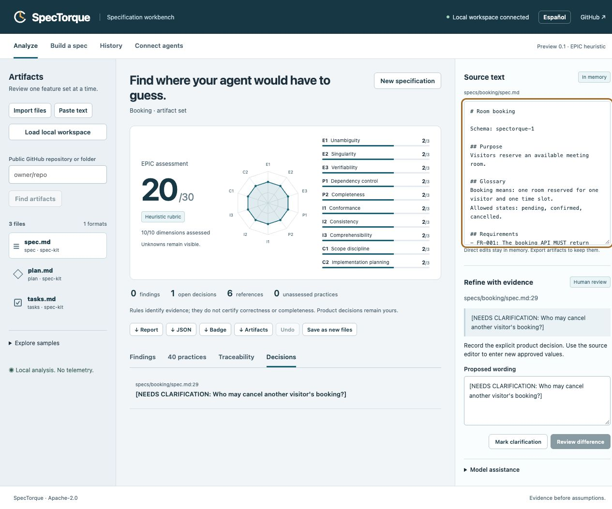

# SpecTorque

**Find where your coding agent would have to guess.**

Create, inspect and refine specifications with a local workbench, a shared TypeScript engine, CLI, MCP tools and host integrations. EN/ES analysis. No GPU, account or model needed for the basic workflow.

> **0.1.0 preview:** executable foundations, not the completed December V1. See [tested compatibility](docs/compatibility.md) and [delivery milestones](docs/roadmap.md). Native adapters are qualified separately from core tests.



## Try it

Requires Node.js **22.20+** and npm. From a source checkout:

```sh
git clone https://github.com/jayanez/spec-torque.git
cd spec-torque
npm ci --ignore-scripts
npm run build
node dist/cli.js serve --root /absolute/path/to/your/project
```

Open the printed loopback URL. Start with the built-in original samples, import Markdown, load your local workspace, paste text, or import a public GitHub repository. Select a finding, inspect its exact source, propose a rewrite, review the difference, accept/reject, then export. Direct editor drafts stay in memory until exported. Disk writes need a separate explicit action and reject stale content.

```sh
node dist/cli.js analyze fixtures --json
node dist/cli.js report fixtures --output report.md
node dist/cli.js create --answers fixtures/builder-en.json
node dist/cli.js mcp
npm run check
npm run package:integrations
```

Creation previews by default; `--apply` writes new files only. Reports refuse to overwrite existing files. `--min 23`, `--require-complete` and `--fail-on-open` are explicit CI policies; unknown dimensions fail `--min` rather than receiving invented scores.

## What the preview does

- Guided spec, plan and tasks with stable IDs and explicit unanswered questions.
- Layout hints for Spec Kit/Kitty, OpenSpec, Kiro, BMAD, ZeeSpec and generic Markdown/PRDs; feature grouping and archive exclusion.
- Forty attributed EPIC practice checks, a ten-dimension radar, exact evidence, requirement references and EN/ES wording checks.
- Reviewed line proposals preserving numbers, normative words and IDs; stale-write detection, local undo, Markdown/JSON reports and revision-bound SVG badges.
- Optional host-model prompts, local Ollama or explicitly configured OpenAI rewriting. Model outputs never earn deterministic points.
- Six read-only MCP tools and four visual adapters sharing the same engine.

**A heuristic score is not a certification, a reproduction of the paper's human scoring, or a prediction of defect rates.** Unknown evidence remains unknown. Cross-feature companion checks require selecting one feature. Semantic preservation still needs human review.

## Documentation

[Rubric](docs/rubric.md) · [Constitution](CONSTITUTION.md) · [Requirements](docs/requirements.md) · [Architecture](docs/architecture.md) · [Research and article analysis](docs/research.md) · [Integrations](docs/integrations.md) · [Privacy](docs/privacy.md) · [Evaluation](docs/evaluation.md) · [Español](docs/es.md)

Apache-2.0 for original code and documentation. EPIC-derived paraphrases have separate CC BY 4.0 attribution in [NOTICE](NOTICE). No affiliation or endorsement is implied. [Contribute](CONTRIBUTING.md) through the [issue tracker](https://github.com/jayanez/spec-torque/issues).
