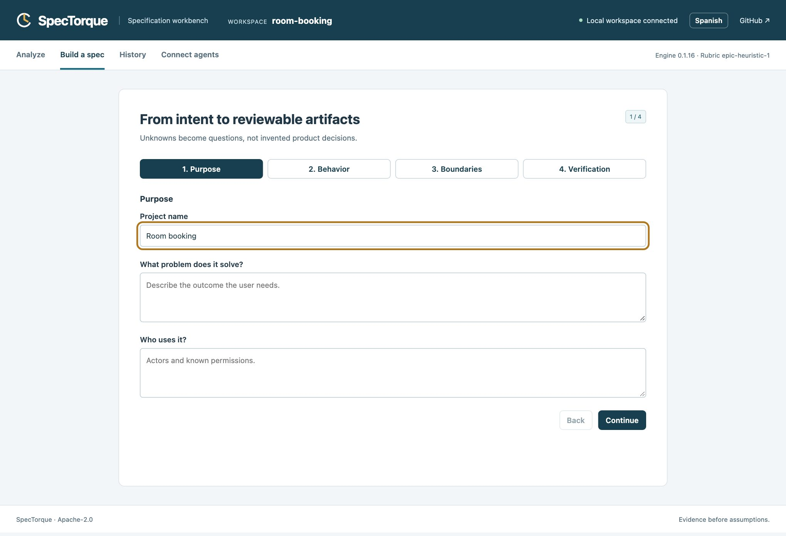
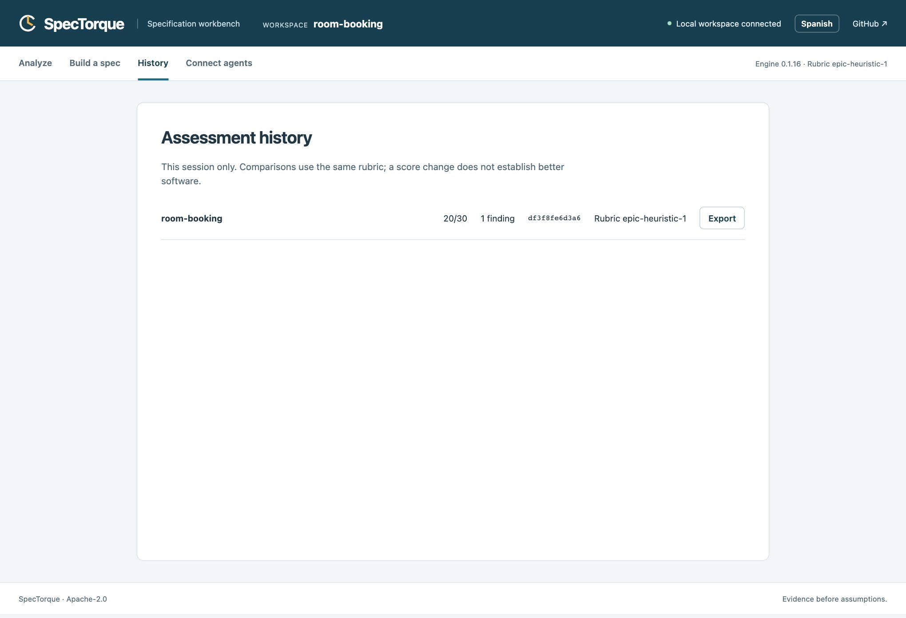
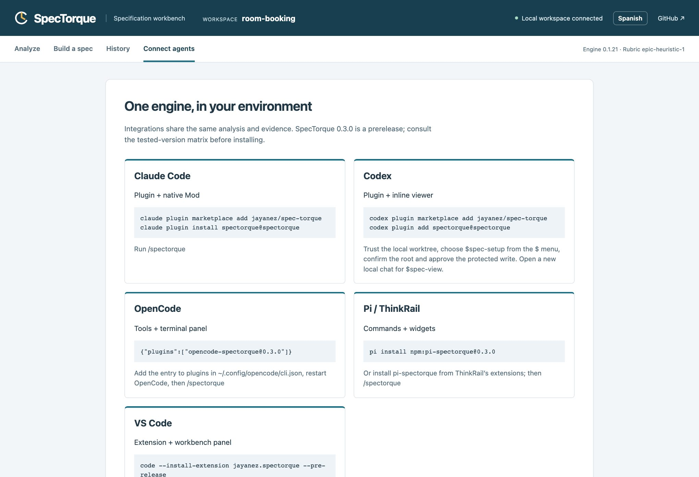
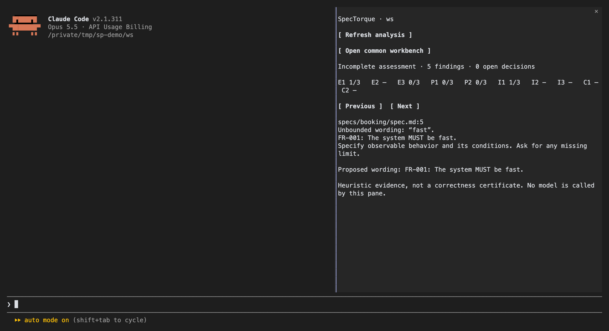
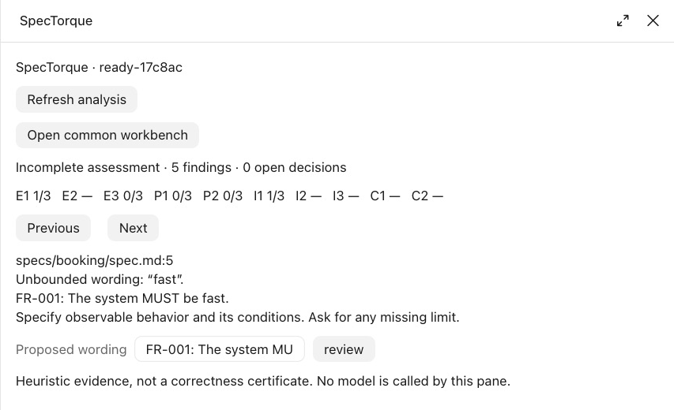
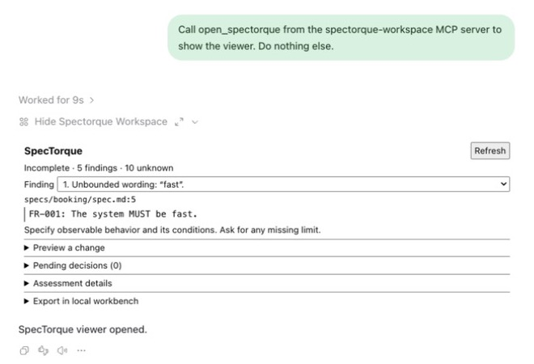
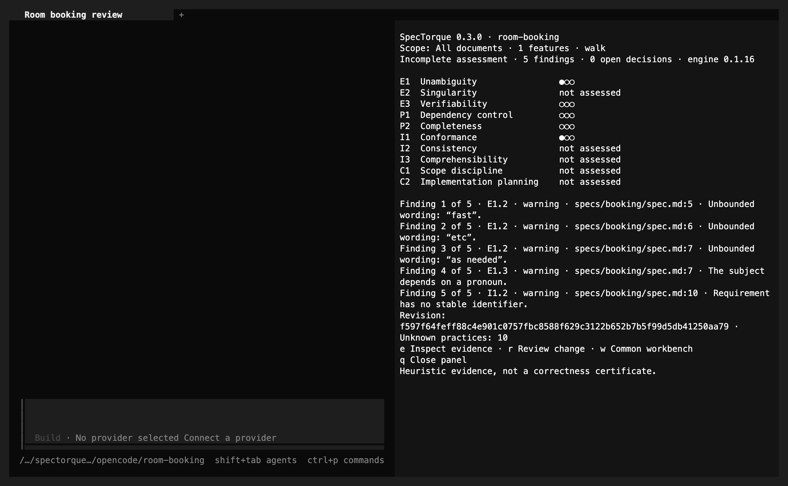
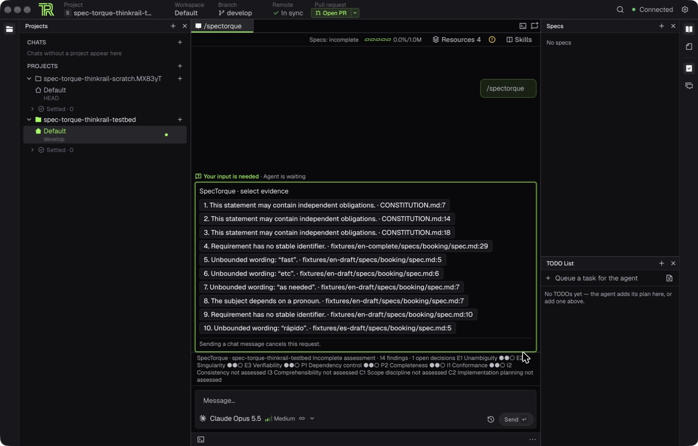
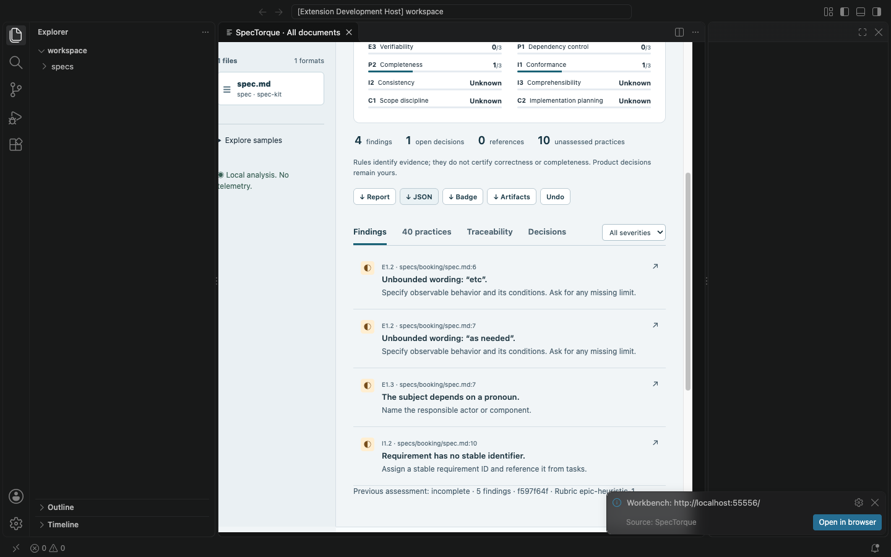
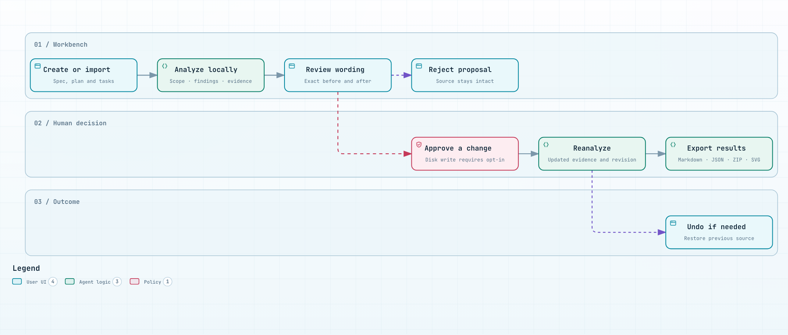

# SpecTorque

<p align="center">
  <a href="https://github.com/jayanez/spec-torque/releases"></a>
  <a href="https://github.com/jayanez/spec-torque/actions/workflows/check.yml?query=branch%3Adevelop"></a>
  <a href="LICENSE"></a>
</p>

<p align="center">
  <a href="docs/integrations.md#claude-code"></a>
  <a href="docs/integrations.md#codex-desktop"></a>
  <a href="docs/integrations.md#opencode"></a>
  <a href="docs/integrations.md#pi"></a>
  <a href="docs/integrations.md#vs-code-workbench"></a>
  <a href="docs/integrations.md#mcp-and-skills"></a>
</p>

**See where your coding agent would have to guess.**

SpecTorque is a local workbench for writing and reviewing software specifications. It takes you from a rough idea or an existing Markdown workspace to a spec, plan and tasks with traceable requirements, reviewable changes and explicit open decisions.

[Quickstart](#quickstart) · [How it works](#how-it-works) · [Research basis](#why-wording-matters) · [Tested compatibility](docs/compatibility.md) · [Guía en español](docs/es.md)

**40 EPIC practice checks · 10 quality dimensions · English and Spanish · One deterministic engine**

## Quickstart

Requires **Node.js 22.20+** and npm.

```sh
git clone https://github.com/jayanez/spec-torque.git
cd spec-torque
npm ci --ignore-scripts
npm run build
node dist/cli.js serve --root fixtures/en-draft
```

Open the printed loopback URL. Select the finding for `FR-001`, jump to its source line, and review the suggested clarification. To use your own Markdown workspace, replace `fixtures/en-draft` with its path.

Download the CLI package or a host integration from the [0.2.0 pilot prerelease](https://github.com/jayanez/spec-torque/releases/tag/v0.2.0), or follow the [EN/ES pilot walkthrough](docs/pilot.md) and its [Spanish version](docs/pilot.es.md). See the [qualification record](docs/common-workbench-qualification.md) for observed results and remaining checks.

## Why wording matters

> **FR-001** The system MUST be fast.

**Precision** makes a requirement verifiable. For this booking draft, the word **fast** leaves the response-time limit and the conditions for measuring it open. **Selectivity** means asking for the missing decision that would change implementation or acceptance. SpecTorque cites the source line and leaves the limit open for the team to decide.

- **EPIC defines what to review.** Claudino et al. assessed specifications, plans and tasks from 114 open-source repositories using ISO/IEC/IEEE 29148 as a reference. They derived 40 practices across ten dimensions, then sought feedback from 15 practitioners. The study observed a lower share of bug-fix commits in repositories with higher-rated specifications. Its observational design supports an association. [The EPIC Framework for Spec-Driven Development](https://arxiv.org/abs/2610.07534)
- **Wording can flag requirements that need review.** Femmer et al. found that lightweight checks surfaced relevant requirements problems, with detection accuracy varying substantially across cases. [Requirements Smells](https://doi.org/10.1016/j.jss.2016.02.047)
- **Ambiguity can change program behavior.** Mu et al. used divergent outputs from candidate implementations to identify requirements worth clarifying in function-generation benchmarks. [ClarifyGPT](https://doi.org/10.1145/3660810)
- **Agent studies examine when to ask.** On an underspecified variant of SWE-bench Verified, Edwards and Schuster's uncertainty-aware setup asked fewer questions on simpler tasks and sought more information on complex ones. That finding applies to the systems and tasks evaluated in the study. [Ask or Assume?](https://arxiv.org/abs/2603.26233)

EPIC is the basis for SpecTorque's rubric. SpecTorque implements explainable English and Spanish heuristics, cites the evidence behind each finding, and keeps unsupported evidence and unresolved decisions visible. Scores are advisory. Estimating the tool's effect on implementation defects would require a separate outcome study. [Rubric](docs/rubric.md) · [Research methods and limitations](docs/research.md) · [EN/ES corpus and reproduction](docs/format-corpus.md)

## Explore the workbench

Expand a view to read its description and see the capture. Click the image for the original size.

<details open>
<summary><strong>Analyze</strong></summary>

Inspect findings at their exact source lines and see which dimensions are still unknown.

[](docs/assets/workbench/analyze.jpg)

</details>

<details>
<summary><strong>Build a spec</strong></summary>

Answer guided questions to turn a project brief into a spec, plan and tasks.

[](docs/assets/workbench/build.jpg)

</details>

<details>
<summary><strong>History</strong></summary>

Revisit earlier assessments, check their revision and rubric version, and export the report you need.

[](docs/assets/workbench/history.jpg)

</details>

<details>
<summary><strong>Connect agents</strong></summary>

Find the host integration guides and copy the local MCP configuration for your project.

[](docs/assets/workbench/connect.jpg)

</details>

## Native panels

Each integration brings the same engine into the host you already use. The captures use the bundled booking draft or, in ThinkRail, a SpecTorque test checkout with repository fixtures. Check [tested compatibility](docs/compatibility.md) for the host versions we observed.

<details>
<summary><strong>Claude Code (CLI)</strong> · <code>/spectorque</code> pane</summary>

Read dimension scores and findings beside the conversation, refresh the analysis or open the common workbench. The pane calls no model. [Install for Claude Code CLI](docs/integrations.md#claude-code)

[](docs/assets/panels/claude.png)

</details>

<details>
<summary><strong>Claude Code Desktop</strong> · <code>/spectorque</code> pane</summary>

Install the plugin from a local marketplace at project scope. Start a session in the Code tab, then run `/spectorque` to view dimension scores and findings in the native pane. Starting the session takes a model turn. The pane runs its analysis locally. [Install for Claude Desktop](docs/host-common-qualification.md#claude-desktop)

[](docs/assets/panels/claude-desktop.png)

</details>

<details>
<summary><strong>Codex Desktop</strong> · inline viewer</summary>

The viewer opens in the conversation from the project's local MCP server. Choose a finding, preview a change, then hand off to the local workbench to approve or export. Opening it takes one model turn. [Install the Codex Desktop viewer](integrations/codex/README.md)

[](docs/assets/panels/codex.jpg)

</details>

<details>
<summary><strong>OpenCode</strong> · <code>/spectorque</code> panel</summary>

Press **e** for the exact source line, **r** for reviewed changes and **w** for the local workbench URL. [Install for OpenCode](docs/integrations.md#opencode)

[](docs/assets/panels/opencode.png)

</details>

<details>
<summary><strong>Pi</strong> · <code>/spectorque</code> in ThinkRail</summary>

Pi is shown through ThinkRail, a desktop host that runs Pi natively. Pick a finding to open its exact evidence, then review the before and after wording. The workspace in this capture is a SpecTorque test checkout, so it lists findings from the repository's own fixtures. [Install in ThinkRail](docs/host-common-qualification.md#thinkrail-desktop-with-pi-package) · [Install for Pi CLI](docs/integrations.md#pi)

[](docs/assets/panels/pi.jpg)

</details>

<details>
<summary><strong>VS Code</strong> · embedded workbench (preview)</summary>

The shared workbench opens in an editor tab, with findings that jump to source. [Install the VS Code preview](docs/integrations.md#vs-code-workbench)

[](docs/assets/panels/vscode.png)

</details>

See the [integration guides](docs/integrations.md) for each host's behavior and limits.

## How it works

[](docs/assets/workbench/workflow.png)

1. **Create or import.** Start with guided questions or load existing documents. Select the scope you want the local engine to assess.
2. **Review and decide.** Follow a finding to its source and compare the exact wording. Rejection leaves the source intact. Approval updates the draft, with a separate opt-in for writing to disk.
3. **Reanalyze and hand off.** Inspect the new revision and its pending decisions. Export the current assessment and selected artifacts, or undo the change where applicable. You can also export an assessment before proposing an edit.

[Archify diagram source](docs/assets/workbench/workflow.archify.json)

## From draft to reviewed handoff

| Step | What you can do |
| --- | --- |
| **Create or import** | Generate spec, plan and tasks from guided questions with stable requirement IDs. Start from a sample, paste text, import Markdown files, load a local workspace or explicitly import a public GitHub repository. |
| **Scope the review** | Discover features and document roles across Spec Kit, Spec Kitty, OpenSpec, Kiro, BMAD, ZeeSpec and generic Markdown/PRDs using layout hints. Review all active artifacts or one feature. Archived artifacts stay outside active analysis. |
| **Inspect the evidence** | Explore a ten-dimension radar, all 40 practices, findings, requirement references and pending decisions. Jump to the cited path and line. Missing evidence remains visible as unknown. |
| **Decide and revise** | Compare exact before and after wording. Guarded proposals check identifiers, quantities and obligations. Reject or explicitly approve, reanalyze and undo where applicable. Disk writes require a separate opt-in and reject stale source. |
| **Share the result** | Export editable artifacts as a scoped ZIP with original paths, download Markdown or JSON reports and a revision-bound SVG badge, or revisit a prior assessment in session history. Save or export unsaved drafts before ending the session. |

The basic workflow runs locally without an account, a model, a GPU or telemetry. Model assistance is optional through a host prompt, local Ollama or an explicitly configured OpenAI request. See [privacy and data flows](docs/privacy.md).

## Browser, CLI and coding agents

The workbench, CLI and six read-only MCP tools share the same analysis engine. Integrations and portable skills cover Claude Code, Codex, OpenCode and Pi. The project also provides a VS Code workbench preview. See the [native panels](#native-panels) and check the tested routes and versions before installing. [Integration guides](docs/integrations.md) · [Compatibility matrix](docs/compatibility.md)

```sh
node dist/cli.js analyze fixtures/en-complete --json
node dist/cli.js create --answers fixtures/builder-en.json
node dist/cli.js mcp
```

For CI, opt into policies such as `--require-complete`, `--fail-on-open` or `--min 23`. An unknown total fails the minimum-score check. Use `npm run check` and `npm run package:integrations` to verify a source checkout.

[Architecture](docs/architecture.md) · [Requirements](docs/requirements.md) · [Roadmap](docs/roadmap.md) · [Contributing](CONTRIBUTING.md) · [Español](docs/es.md)

Original code and documentation are licensed under [Apache-2.0](LICENSE). EPIC-derived paraphrases carry separate CC BY 4.0 attribution in [NOTICE](NOTICE).
