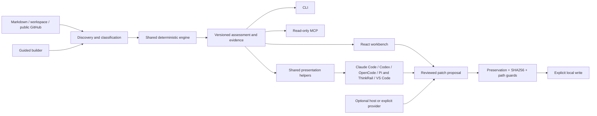

# Architecture

`src/core` runs in Node and the browser without host services. `src/node` owns bounded filesystem/network access, the work-tree index, loopback sessions and optional providers. `src/integration.ts` exposes shared functions and types to adapters, and `src/core/presentation.ts` gives every host the same title, summary, dimensions, finding card, scope vocabulary and disclaimer (`tests/parity.test.ts` checks the hosts agree). The CLI and MCP share these boundaries. Each host package bundles these modules into its own runtime; see [distribution](#distribution).

## Engine pipeline

Discovery builds a path-only index, then reads the selected scope. Classification assigns roles from layout hints: spec, plan, tasks, instruction file, or context (`quickstart.md` counts only as validation evidence; Spec Kit `checklists/` are review context and never requirements or open decisions). Normative recognition finds whole EN/ES obligation, recommendation and permission words. A requirement ID defines a requirement only in a defining position, and a hard-wrapped continuation belongs to its item. References resolve in the selected feature's namespace; plan-local labels and IDs qualified by another specification are not undefined references. Line and document rules then evaluate the 40 practices, findings carry exact evidence, and scoring follows the policy below. Each rule change that can alter results bumps `ENGINE_VERSION` and is recorded with its replay in [precision decisions](precision-decisions.md).

## Public contracts

- `ArtifactSet`: named artifact collection; each artifact has a relative path, content, feature, role, framework hint and archive marker.
- `Finding`: practice, severity, message, suggestion and exact path/line/text evidence; provenance is `rule`.
- `Assessment`: schema, engine and rubric versions, SHA256 revision identity, artifact hashes, forty practice results, dimensions, decisions and reference graph.
- `PatchProposal`: source path, line, original/replacement, base hash, reason and human/host/provider origin.

Types live in `src/core/types.ts`; runtime boundary schemas in `src/node/schemas.ts`. Breaking changes require a schema-version change and migration notes. Discovery, creation, assessment, clarification context, proposal and export operations are exposed by CLI/MCP/UI as appropriate. MCP never writes files.

## Scoring and limits

Signals map to supported=1, partial=0.5 and missing=0 within each dimension, then round to 0–3. Unknowns prevent that dimension receiving a score; explicit non-applicability removes the practice from the denominator. No total is produced while a dimension is unknown. This is an original heuristic, not the paper's calibrated scoring method. Multi-feature ID/reference checks are scoped; companion completeness needs a single selected feature.

Layout classification is a hint, not proof of framework ownership. Regex signals do not establish semantic consistency, stakeholder coverage or complete traceability. Only explicit opposite obligations are flagged as contradictions. Code/test implementation checking is outside V1.

Feature scopes include active instruction files from ancestor directories,
including the workspace root. References remain scoped to the selected
feature's ID namespace. The local [corpus evaluator](format-corpus.md)
compares revisions through shared discovery and analysis and tests these
boundaries independently of the host adapters.

## Discovery criteria

Discovery analyzes the work tree you are in, on its checked-out branch, as it is on disk ([#68](https://github.com/jayanez/spec-torque/issues/68)). Configuration may only widen discovery, and only inside the work tree. Invocation modifiers only narrow it.

| Level | Rule |
|---|---|
| Boundary | The implicit root is the git toplevel of the current directory, or the directory itself outside git. An explicit root (`--root`, `SPECTORQUE_ROOT`, `analyze <folder>`) is used as given, with paths relative to it. Inside a work tree, files come from `git ls-files --cached --others --exclude-standard`: uncommitted edits and unadded drafts are included, ignored paths and files missing from disk are not. Nested work trees, submodules and repositories are never crossed. Without git, or for an explicit root that its repository ignores, a bounded walk runs instead and stops at nested `.git` folders. The fixed exclusions (`node_modules`, `.venv`, `dist`, `.env*`, symbolic links…) apply in both modes. Git runs without a shell, with `core.fsmonitor` disabled and repository overrides removed from the environment. |
| Default scope | A path-only index classifies every candidate without reading content. Only the selected scope plus its ancestor instruction files is read, and the 500-artifact limit applies to that read. When the current directory is below the root, it is the default focus, while classification stays relative to the root. |
| Templates | Framework scaffolding is not a candidate ([#92](https://github.com/jayanez/spec-torque/issues/92), H92a): the installed template folders `.specify/templates/`, `.specify/{presets,extensions}/<name>/templates/`, `.kittify/templates/` and `.kittify/[overrides/]missions/<mission>/{templates,command-templates}/`, at any depth of the repository. No host lists, reads or scores those files, and the workbench folder import drops them too. A `templates` folder anywhere else, including inside a feature under `.specify/specs/` or `.kittify/specs/`, is project content. A `--path`, `--feature`, focus or GitHub tree URL that names a template folder fails with a reason. An explicit input is still read: a single file, a root chosen inside a template folder, or artifact text supplied by the caller. |
| Features | `listFeatures` returns non-archived feature IDs that contain a spec. Known layouts come first and generic groups last, each sorted by ID. Every adapter uses this list. |
| Widen | An optional `.spectorque.json` at the root: `include` (relative globs that re-include ignored paths) and `submodules` (initialized submodules). Escapes, absolute paths and pathspec magic are rejected, and invalid configuration is an error. Configuration cannot change the root or raise the limit. |
| Narrow | `feature`, `paths` or `changed` (features with changes since the merge-base with the remote default branch or an explicit base, including uncommitted edits). They are available on the CLI, in MCP and in host adapters. Only one applies at a time. |

The index and `features` output state the mode (`git` or `walk`) and the root. `ArtifactSet` and `Assessment` are unchanged. A review across more features than the limit aggregates one feature at a time; the limit is not raised.

## Distribution

`scripts/package-integrations.mjs` bundles the engine into each host folder. Those folders are npm packages (`spectorque-claude`, `spectorque-codex`, `opencode-spectorque`, `pi-spectorque`) beside the root `spectorque` CLI; the Claude and Codex catalogs at the repository root install them from npm, and the VSIX goes to the VS Code Marketplace and Open VSX. All share the root product version. See [releases](releases.md#versioning-and-releases).

## Reversible implementation choices

Node 22 plus a single TypeScript motor minimizes adapter drift. React/esbuild serves a shared local workbench; adapters are thin views. Bounded in-memory session state avoids a database dependency. No ADR workflow or server deployment is required. Meaningful changes to these choices are recorded with their implementation issue/PR.
