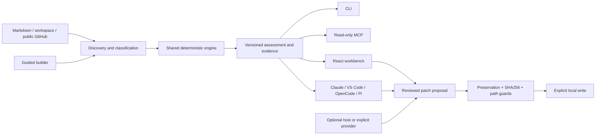

# Architecture

`src/core` runs in Node and the browser without host services. `src/node` owns bounded filesystem/network access, loopback sessions and optional providers. `src/integration.ts` exposes shared functions to adapters. The CLI and MCP share these boundaries.

## Public contracts

- `ArtifactSet`: named artifact collection; each artifact has a relative path, content, feature, role, framework hint and archive marker.
- `Finding`: practice, severity, message, suggestion and exact path/line/text evidence; provenance is `rule`.
- `Assessment`: schema, engine and rubric versions, SHA256 revision identity, artifact hashes, forty practice results, dimensions, decisions and reference graph.
- `PatchProposal`: source path, line, original/replacement, base hash, reason and human/host/provider origin.

Types live in `src/core/types.ts`; runtime boundary schemas in `src/node/schemas.ts`. Breaking changes require a schema-version change and migration notes. Discovery, creation, assessment, clarification context, proposal and export operations are exposed by CLI/MCP/UI as appropriate. MCP never writes files.

## Scoring and limits

Signals map to supported=1, partial=0.5 and missing=0 within each dimension, then round to 0–3. Unknowns prevent that dimension receiving a score; explicit non-applicability removes the practice from the denominator. No total is produced while a dimension is unknown. This is an original heuristic, not the paper's calibrated scoring method. Multi-feature ID/reference checks are scoped; companion completeness needs a single selected feature.

Layout classification is a hint, not proof of framework ownership. Regex signals do not establish semantic consistency, stakeholder coverage or complete traceability. Only explicit opposite obligations are flagged as contradictions. Code/test implementation checking is outside V1.

## Reversible implementation choices

Node 22 plus a single TypeScript motor minimizes adapter drift. React/Vite serves a shared local workbench; adapters are thin views. Bounded in-memory session state avoids a database dependency. No ADR workflow or server deployment is required. Meaningful changes to these choices are recorded with their implementation issue/PR.
