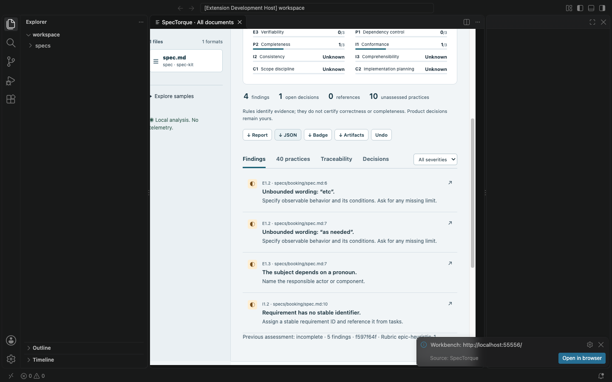

# SpecTorque for VS Code

Find where your coding agent would have to guess. SpecTorque scores specifications, plans and tasks against 40 EPIC practices, cites the exact source line for every finding and applies a refinement only after you review the difference.

## Use

Open a trusted project and run **SpecTorque: Open Specification Workbench** from the command palette. Choose **All documents**, **Changed on this branch** or a feature. The extension starts a loopback server with the bundled shared engine and displays the common workbench in an editor tab. No model or credentials are needed for analysis, and nothing leaves your machine.

Requires a trusted workspace (the workbench can apply explicitly reviewed edits) and VS Code 1.100 or later. Cursor, Windsurf and VSCodium can install the same extension from Open VSX; they are not yet qualified.

See the [repository](https://github.com/jayanez/spec-torque) for documentation, the [privacy notes](https://github.com/jayanez/spec-torque/blob/develop/docs/privacy.md) and the tested [compatibility matrix](https://github.com/jayanez/spec-torque/blob/develop/docs/compatibility.md).
